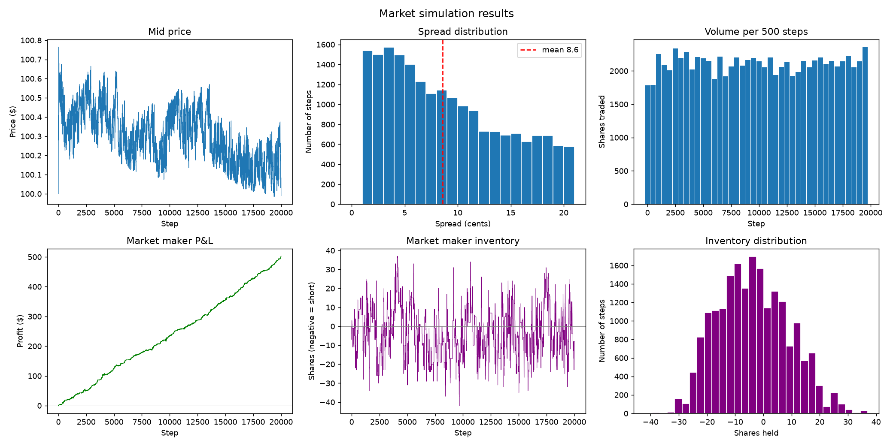

# Market Simulation Engine

A limit order book and matching engine written in C++, paired with a
simulator that populates it with automated traders and a Python toolkit
for analyzing the results.

## Overview

This project models how a financial exchange works under the hood. Orders
are matched using **price-time priority**: the best price executes first,
and orders at the same price are filled in the order they arrived. The
engine supports limit orders, market orders, partial fills, and
cancellations, and records every trade for later analysis.

On top of the engine, simulated traders generate order flow: a random
trader that places and cancels orders around the current price, and a
market maker that quotes both sides of the book and manages its
inventory.

## Features

- Limit order book with bid/ask price levels (prices stored as integer cents)
- Price-time priority matching with partial fills
- Market orders and order cancellation
- Trade log, best bid/ask, spread, and mid price queries
- Automated test suite covering matching, priority, cancels, and queries
- Simulation with a random trader and an inventory-aware market maker
- Python analysis of price, spread, volume, market maker P&L and inventory

## Results

In a 20,000-step run, the market maker earned a steady profit while its
inventory stayed within about ±40 shares, and the average spread settled
around 9 cents.

The market maker profits here because the random traders are uninformed.
Real markets also contain informed traders, who cause adverse selection
losses for market makers. Modeling that is a natural next step.

## Tech stack

- **C++17**: matching engine and simulator
- **Python**: data analysis and plotting (pandas, matplotlib)

## Project structure

    src/        C++ engine (order book, matching) and simulate.cpp
    tests/      Hand-checked matching scenarios
    analysis/   Python plotting script and results chart

## Build and run

Run all commands from the project root.

Run the tests:

    g++ -std=c++17 -Wall -Wextra tests/test_orderbook.cpp src/orderbook.cpp -o build/tests
    ./build/tests

Run the simulation (writes trades.csv and steps.csv):

    g++ -std=c++17 -Wall -Wextra src/simulate.cpp src/orderbook.cpp -o build/sim
    ./build/sim

Plot the results (needs pandas and matplotlib):

    python3 analysis/plot_results.py

## Roadmap

- [x] Order book and limit order matching
- [x] Market orders and cancellations
- [x] Trade log and book queries
- [x] Test suite
- [x] Simulated traders
- [x] Python analysis and plots
- [ ] Informed trader to model adverse selection
- [ ] Sweep market maker spread width vs. profit and risk